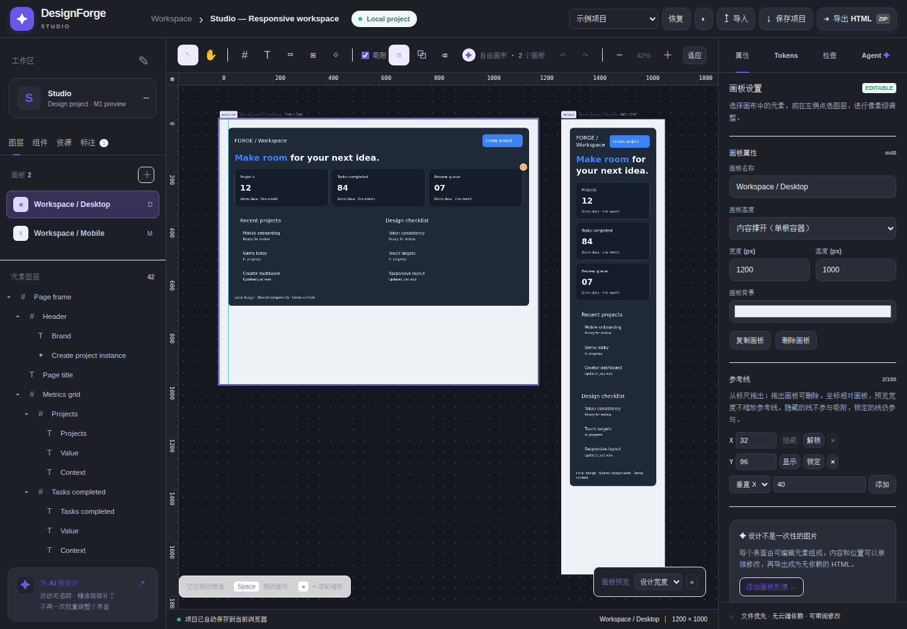

# DesignForge Studio · 形界设计工作台

> **v0.2.0-alpha.4 · M1 基础交付版**。Local-first、AI-native、Agent-friendly UI Design Studio。第一阶段八项交付已通过基础验收；完整范围见 [验收清单](docs/M1_ACCEPTANCE.md)，增强路线及M2/M3继续推进。

## 运行

安装 Node.js 20+，克隆仓库后：

```bash
npm start
```

打开 **http://127.0.0.1:4173/**。编辑器运行时零依赖、无需模型密钥，服务只监听当前电脑的 loopback 地址。没有自动部署。

需要运行开发检查时：

```bash
npm ci
npm test
npx playwright install --with-deps chromium
npm run test:browser
npm run format:check
```

## 本轮可用能力

- **真实图层树**：Frame / Group 嵌套、展开折叠、父容器调整，图层、画布与属性面板同步。原 v1 平铺工程直接打开，不转换、不丢字段。
- **原生布局**：Flex / Grid、方向、间距、内边距、对齐、列数，固定/填充/内容撑开尺寸；父相对位置、五类约束和按画板宽度生效的断点覆盖。预览宽度独立于工程尺寸，Inspector 可切换修改范围、编辑断点宽度、逐字段恢复继承。
- **组件库**：从选中容器创建组件，插入关联实例，切换变体，编辑实例文字覆盖，显式更新组件定义，解除关联后编辑子树。定义内暂不支持嵌套实例。
- **设计系统包**：本地导出/导入 Token、主题、组件和引用资源；冲突拒绝，命名空间隔离，支持不同字体的库复用，保留当前画板与实例。示例 [Studio.library.json](examples/Studio.library.json)。
- **富文本与字体**：在文字框选择字符应用颜色/字号/字重/斜体/下划线/删除线，普通内容编辑保留未改片段格式；Unicode 字素保护。支持节点字体、字体 Token、行高和本地字体资源。
- **设计系统**：颜色及数值 Token、自定义键、别名与循环检测、语义主题、字体与圆角引用。编辑器明暗模式独立于项目主题。
- **标尺与参考线**：相对当前画板的自适应刻度；从标尺拖出参考线、数值编辑、隐藏/锁定、方向键微调，拖出画板删除。参考线随 JSON 保存、可撤销，支持嵌套图层移动吸附；Shift+R 显示/隐藏标尺与线，Alt 暂停吸附。不会写入 HTML 导出。
- **编辑操作**：空白拖动框选、Shift 增选、六向对齐、同父级图层水平/垂直等距分布、组合/解组、整棵子树复制、排序、删除、方向键、拖动；8px 网格和边缘/中心吸附（Alt 暂停）。同父级自由布局的多选图层可整体调整盒子与间隙，单选图层提供尺寸拖拽，Shift 等比、自由布局 Alt 中心缩放，Esc/取消回滚，松手只提交一次。自由布局编辑与 Auto Layout 的位置管理分开。
- **本地资源**：PNG/JPEG/WebP/GIF、受限 SVG、WOFF/WOFF2/TTF；内嵌项目及 HTML 导出，无外链请求。单资源编码后最多 512 KB，总计 1 MB。SVG 拒绝脚本、外部引用、HTML、CSS、实体与未知标签/属性。
- **保存与恢复**：当前项目自动保存、最多 8 个旧快照（并受总大小预算约束）、损坏存档回退、手动选择备份恢复、35 步内存 Undo/Redo。JSON/HTML/ZIP 原有导出保留。
- **Agent Patch**：保持 `designforge.patch` v1、必需 baseHash、字段白名单、原子应用与人工确认；扩展嵌套操作、受限布局编辑和移动节点，Diff 显示父级/顺序变化。
- **示例**：原 Orbit 三画板 170 节点保持不变；新增 Studio 响应式双画板、Settings、Kanban、Messages、Pricing、SignIn、Storefront、Files、横竖屏游戏 HUD 共 10 个工程。顶部菜单可打开，打开操作可撤销。

## 实际验证

CI 分开运行 Node 测试和真实 Chrome（Chromium 引擎）测试，浏览器截图/失败追踪保存在对应 Actions 的 `browser-evidence` artifact（保留 14 天）。测试覆盖嵌套编辑、撤销/重做、保存回读、组件变体、资源导入、鼠标拖动、响应式导出及原 M0 回归。本轮146项Node和80项真实Chrome通过；最新结果及已知边界见 [验证记录](docs/VALIDATION.md) 和 [已知问题](docs/KNOWN_ISSUES.md)。

检查面板可运行实际DOM几何检查及约+30%文字膨胀预检（离屏副本，不改原稿），报告可导出并标记过期。

浏览器断言不是视觉差异基准，也不是 WCAG 认证；Firefox、Safari、真实触屏设备尚未验收。

## 真实浏览器截图



[富文本](docs/screenshots/m1-richtext.png) · [多选缩放](docs/screenshots/m1-multiresize.png) · [设计系统包](docs/screenshots/m1-library.png) · [浏览器检测](docs/screenshots/m1-audit-final.png) · [文字膨胀预检](docs/screenshots/m1-text-expansion.png) · [浅色参考线](docs/screenshots/m1-guides-light.png) · [深色参考线](docs/screenshots/m1-guides-dark.png) · [等距分布](docs/screenshots/m1-distribution.png) · [尺寸手柄](docs/screenshots/m1-resize.png) · [断点编辑](docs/screenshots/m1-breakpoints.png) · [框选](docs/screenshots/m1-marquee.png) · [1024px 编辑器](docs/screenshots/editor-1024.png) · [390px 响应式导出](docs/screenshots/studio-mobile.png) · [验收范围及限制](docs/VALIDATION.md)

## 使用 Agent

选中元素 → Agent 面板填写要求 → 复制指令并提供最新 JSON → 导入 Patch → 查看差异摘要 → 人工批准。没有内置模型调用。仓库附带跨 Agent 的 `skills/designforge/SKILL.md`。

```bash
node tools/forge.mjs validate examples/Studio.project.json
node tools/forge.mjs audit examples/Studio.project.json
node tools/forge.mjs export examples/Studio.project.json ./output-studio
node tools/forge.mjs apply examples/Orbit.project.json examples/Rename-revenue.patch.json --out revised.project.json
```

`apply` 输出文件必须不存在，禁止原文件、已存在文件或符号链接别名覆盖。协议和坐标语义见 [PATCH_PROTOCOL](docs/PATCH_PROTOCOL.md)。

## 尚未完成

当前仍缺断点可视化范围条、嵌套组件实例与跨项目在线库版本同步；多选缩放限同父级基础样式，Flow/断点模式会明确拒绝。当前导出为静态 HTML/CSS。自然语言生成、BYOK 模型、截图/HTML 重构和可视化审批属于 M2；React/Vue、交互原型与完整自动化视觉质量闭环属于 M3。不要把本版当作完整 Figma 替代品。

## 工程与许可

`src/core.mjs` 协议/渲染/补丁，`tree.mjs` 树编辑，`geometry.mjs` 尺寸/框选/分布/吸附，`guides.mjs` 参考线数据/刻度，`responsive.mjs` 断点继承，`viewport.mjs` DOM 测量/预览，`assets.mjs` 资源边界，`storage.mjs` 本地恢复；`app.mjs`/`app.css` 工作台，`tools/` CLI/开发服务器，`tests/` 单元与浏览器测试，`examples/` 可编辑项目。

原创代码 MIT。独立实现，没有复制 BaoCut 受限源码或品牌资源，不是 BaoCut / Anthropic 官方产品。研究来源和许可说明见 [RESEARCH](docs/RESEARCH.md)。

浏览器存储和备份均不替代文件备份；清理站点数据仍会丢失浏览器内项目，请保留 JSON 导出。超出存储额度时明确提示手动保存，不清空旧存档腾空间。
